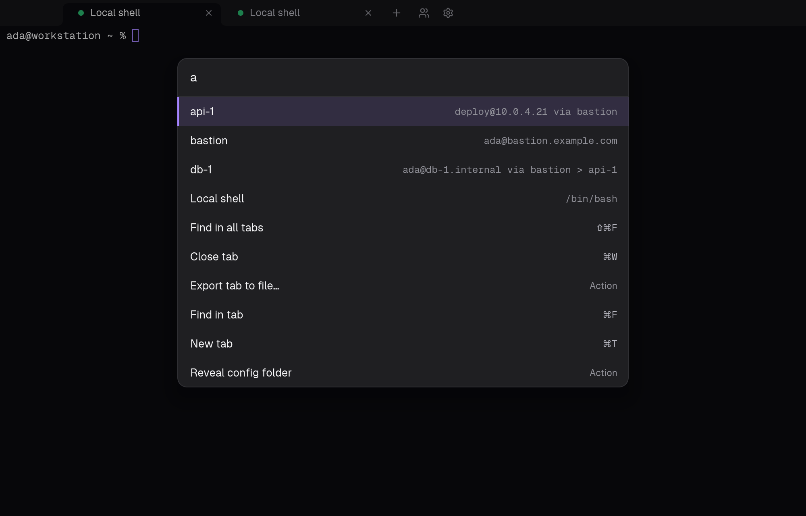

# featherbit terminal

A native, SSH-first terminal emulator for macOS, Linux and Windows, written in Rust. It stays fast and light with many sessions open: twenty tabs with full scrollback take about 123 MB of memory.

 



## Documentation

Full documentation: [featherbitplatform.github.io/terminal](https://featherbitplatform.github.io/terminal/). Source in [`website/`](website/) (Docusaurus); run it locally with `cd website && npm install && npm start`.

## Install

Download from the [latest release](https://github.com/featherbitplatform/terminal/releases/latest); each file comes with a `.sha256` checksum, and releases from 0.3.0 on also carry CycloneDX SBOMs of the app and the docs site. Builds are not signed yet, so each system asks you to confirm the first launch.

- **macOS:** the universal `.dmg` for Apple Silicon and Intel Macs. See [Install on macOS](https://featherbitplatform.github.io/terminal/install-macos).
- **Linux:** `.deb` (Debian 12 and Ubuntu 22.04 and newer), `.rpm` (Fedora 39 and RHEL 9 and newer) or `.tar.gz`, for x86_64 and aarch64. See [Install on Linux](https://featherbitplatform.github.io/terminal/install-linux).
- **Windows:** the `.msi` for Windows 11 (x64). See [Install on Windows](https://featherbitplatform.github.io/terminal/install-windows).

## Features

- **SSH profiles**: password, private key (with or without passphrase) and ssh-agent authentication, jump hosts through other saved profiles, one shared connection per profile. Host keys are checked against `~/.ssh/known_hosts`, with a prompt for unknown hosts; changed keys are refused.
- **Saved secrets**: passwords and passphrases live in the system storage or an encrypted vault with a main password, never in config files.
- **Quick-launch palette** (Cmd+Shift+P): fuzzy search over profiles and app actions.
- **Tabs and windows**: multiple windows, per-profile tab colors, layout restored on relaunch.
- **Find**: in a tab's scrollback or across all tabs; export a tab's history to a file.
- **Compact scrollback**: history is stored compactly; the `scrollback_lines` setting applies to open tabs.
- **Settings** window and a plain `settings.toml` that reloads live; configurable keyboard shortcuts.
- **GPU rendering** with the Graphite theme; redraws are paced and hidden tabs do no render work.

Local shells work too: shells from `/etc/shells` are offered automatically.

## Build from source

Requires a recent stable Rust toolchain (edition 2024).

```bash
cargo run -p fbterm            # build and run
cargo test --workspace         # tests
bash dev/package-macos.sh 0.5.0  # universal .app and .dmg into target/dist/ (macOS only)
bash dev/package-linux.sh 0.5.0 x86_64  # .deb, .rpm, .tar.gz (Linux; see the script)
pwsh dev/package-windows.ps1 0.5.0      # .msi (Windows)
```

The code builds and tests on macOS, Linux and Windows, and releases ship for all three. Terminal emulation comes from [feathercritty](https://github.com/featherbitplatform/feathercritty), our fork of the `alacritty_terminal` crate.

## Contributing

Work happens on `feature/*` branches off `develop` with [Conventional Commits](https://www.conventionalcommits.org/); `main` holds tagged releases only. CI runs `cargo fmt --check`, `cargo clippy -- -D warnings`, `cargo test`, `cargo deny check` and live SSH tests; security scans (semgrep, grype, gitleaks, npm audit) run on every pull request and weekly, and `bash dev/sast.sh` runs them locally.

## License

Apache-2.0, see [`LICENSE`](LICENSE). Third-party licenses are listed in [`LICENSES.md`](LICENSES.md).
